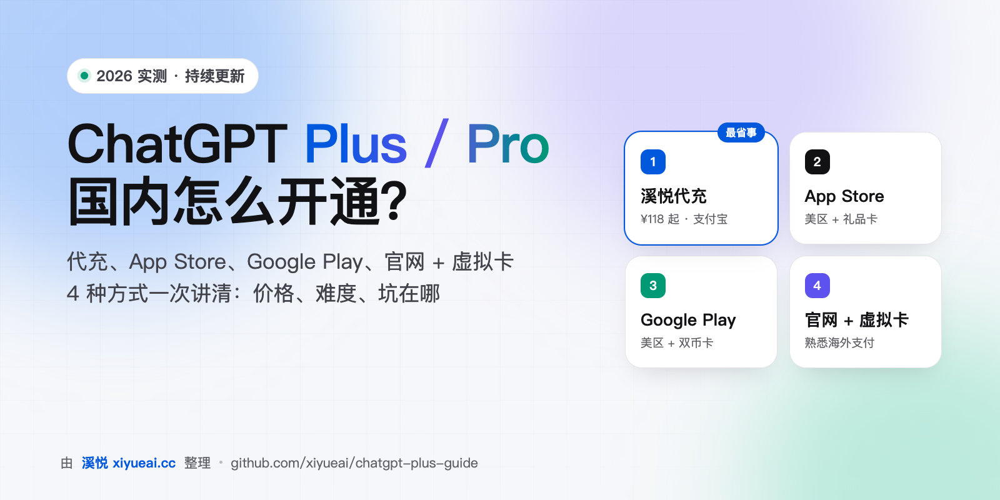
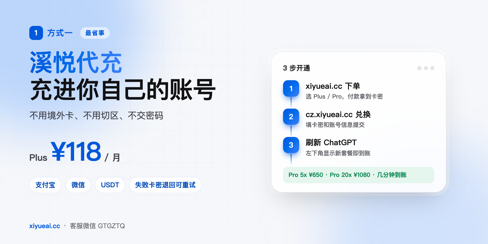
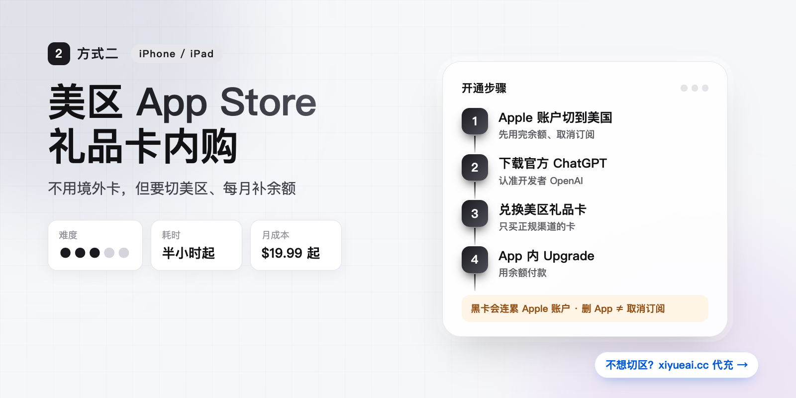
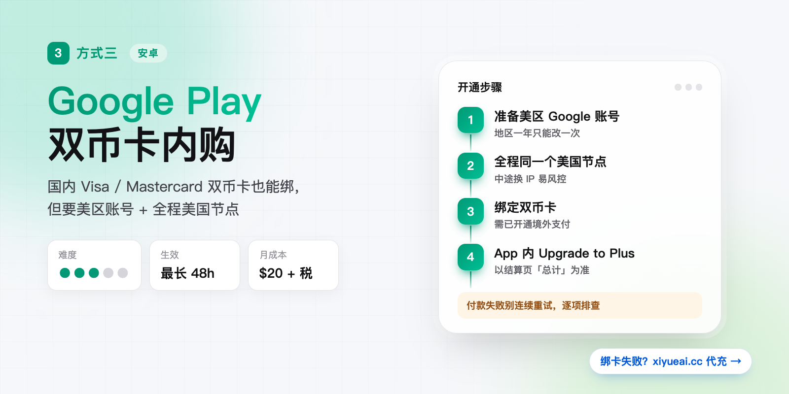
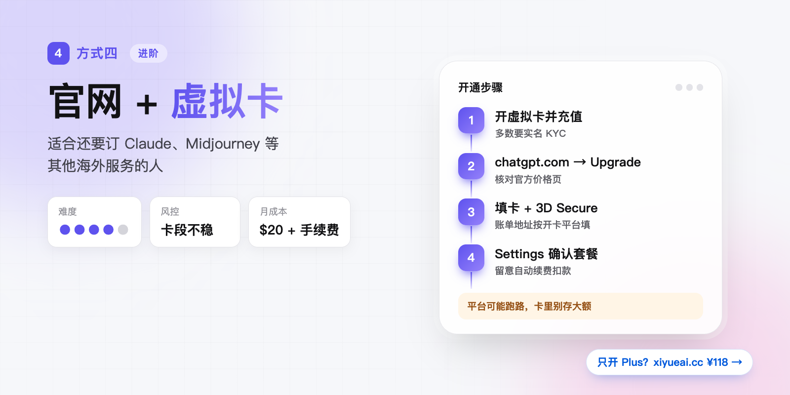

# ChatGPT Plus / Pro 怎么开通？2026 国内 4 种充值方式实测对比（代充 / App Store / Google Play / 虚拟卡）



> 📅 最近更新：2026-10-14 ｜ 价格每次变动都会同步到这里，⭐ Star 一下方便下次找到

> **广告披露：** 本仓库由代充站 [溪悦 xiyueai.cc](https://xiyueai.cc/?utm_source=github&utm_medium=readme&utm_campaign=guide2) 运营者维护，文中「方式一」和标有 💡 的提示为自家广告，其余步骤按官方规则写，供自己动手的人参考。

---

## ⚡ 30 秒选对方式

先回答两个问题：**有没有能付境外订阅的卡？愿不愿意折腾切区、节点？**

| 你的情况 | 推荐方式 | 要准备什么 | 大概多久 |
| --- | --- | --- | --- |
| 没有境外卡，只想尽快用上 | 👉 [方式一：溪悦代充](#方式一溪悦代充最省事) | 支付宝 / 微信 / USDT | 几分钟 |
| 有 iPhone / iPad，愿意切美区 | [方式二：App Store](#方式二美区-app-store-礼品卡内购) | 美区 Apple 账户 + 礼品卡 | 半小时起 |
| 安卓 + 国内双币卡 | [方式三：Google Play](#方式三google-play-双币卡内购) | 美区 Google 账号 + 美国节点 | 半小时起，生效可能要 1~2 天 |
| 熟悉海外支付，还要订别的海外服务 | [方式四：官网 + 虚拟卡](#方式四官网--虚拟卡) | 虚拟卡（需实名、要充值） | 视开卡速度 |

```text
没有境外卡？ ──是──▶ 方式一 代充
     │否
有 iPhone？ ──是──▶ 方式二 App Store
     │否
安卓 + 双币卡？ ──是──▶ 方式三 Google Play
     │否
             ──────▶ 方式四 官网 + 虚拟卡
```

---

## 📚 目录

- [为什么国内开通这么麻烦](#为什么国内开通这么麻烦)
- [方式一：溪悦代充（最省事）](#方式一溪悦代充最省事)
- [方式二：美区 App Store 礼品卡内购](#方式二美区-app-store-礼品卡内购)
- [方式三：Google Play 双币卡内购](#方式三google-play-双币卡内购)
- [方式四：官网 + 虚拟卡](#方式四官网--虚拟卡)
- [四种方式算总账](#四种方式算总账)
- [付款失败报错速查](#付款失败报错速查)
- [开通后：查状态、取消、续费](#开通后查状态取消续费)
- [常见问题 FAQ](#常见问题-faq)

---

## 为什么国内开通这么麻烦

卡在三个地方：

1. **地区：** 中国大陆不在 OpenAI [支持的国家和地区](https://help.openai.com/en/articles/7947663-chatgpt-supported-countries-and-territories) 里，App Store、Google Play 国区都搜不到官方 App。
2. **付款：** 官网订阅走 Stripe 收单，国内卡经常被拒；App 内购又要求商店账号在支持地区。
3. **三套订阅各管各的：** 官网、Apple、Google 的订阅互不相通，在哪买就只能在哪续费、取消、退款。

所以无论选哪种方式，都盯住四件事：**账号是不是你自己的、付款渠道靠不靠谱、出问题有没有人管、会不会泄露账号。**

---

## 方式一：溪悦代充（最省事）



> 🟢 **适合：** 没有境外卡、不想切区挂节点、要中文售后的人。

[溪悦 xiyueai.cc](https://xiyueai.cc/?utm_source=github&utm_medium=readme&utm_campaign=guide2) 用人民币或 USDT 付款，会员直接开在 **你自己的 ChatGPT 账号** 上，不用交密码，也不用换号。

### 💰 价格表（2026-10-14）

| 商品 | 对应官方档位 | 溪悦价格 | 官方价格（参考） |
| --- | --- | --- | --- |
| **ChatGPT Plus 1 个月** | Plus | **¥118** | $20/月 |
| **ChatGPT Pro 5x 1 个月** | Pro $100 档 | **¥650** | $100/月 |
| **ChatGPT Pro 20x 1 个月** | Pro $200 档 | **¥1080** | $200/月 |
| Codex 额度充值 | 250 / 500 / 1000 / 2500 | ¥73 起 | — |

> 价格以 [xiyueai.cc](https://xiyueai.cc/?utm_source=github&utm_medium=readme&utm_campaign=guide2) 商品页实时显示为准。官方价格不含税，App Store / Google Play 的实际扣款通常更高。

### ✅ 为什么选它

- **付款简单：** 支付宝 / 微信 / USDT 都行，不用境外卡，不用切 Apple ID 或 Google 地区。
- **充进你自己的号：** 不用交 ChatGPT 密码，聊天记录、GPTs、项目都还在。
- **全平台通用：** 会员绑在账号上，网页、电脑客户端、手机 App、Codex 登录同一个号都能用。
- **失败可重试：** 开通失败卡密退回，可以重新提交；质保条款以商品页为准。
- **有人管：** 下单、兑换、售后都有中文客服。

### 🧭 开通流程（3 步）

1. 在 [xiyueai.cc](https://xiyueai.cc/?utm_source=github&utm_medium=readme&utm_campaign=guide2) 选好套餐下单，付款后拿到卡密。
2. 打开兑换站 [cz.xiyueai.cc](https://cz.xiyueai.cc)，按页面提示填卡密和账号信息提交。
3. 回到 [chatgpt.com](https://chatgpt.com) 刷新，左下角头像处显示新套餐就是开好了。

### ⚠️ 下单前看一眼

- 自助开通需要提交账号的 **Session**。它不是密码，但属于敏感凭证：开通成功后去 ChatGPT **Settings → Security → 退出所有设备**，交出去的 Session 立刻失效。
- 卡密 **买了就用**，下单 5 天内没用的不退款。
- 代充不是 OpenAI 官方渠道，改变不了 OpenAI 的地区和账号规则。账号本身被风控的话，任何方式都开不了。

> 💬 **客服：** 微信 `GTGZTQ` ｜ QQ `99898089`（加好友备注「溪悦」）。找客服下单免 2% 手续费。

---

## 方式二：美区 App Store 礼品卡内购



> 🍎 **适合：** 有 iPhone / iPad、不介意切换 Apple 账户地区的人。

### 步骤

1. **切到美区：** iPhone「设置 → Apple 账户 → 媒体与购买项目 → 查看账户 → 国家/地区」，选美国，同意条款。切换前要先用完余额、取消正在生效的订阅，不然改不了。账单地址要填美国地址。
2. **下官方 App：** App Store 搜「ChatGPT」，认准开发者是 **OpenAI**，山寨 App 很多。
3. **登录自己的账号：** 用你自己的 OpenAI 账号，别用买来或共用的号。
4. **买美区礼品卡充值：** 正规渠道买美区 App Store 礼品卡，兑换到 Apple 账户余额。
5. **App 内订阅：** ChatGPT App → 头像 → Upgrade，选 Plus 或 Pro，用余额付款。

### 注意

- 订阅由 Apple 扣款，续费、取消、退款都在「设置 → Apple 账户 → 订阅」里处理，**删 App 不等于取消订阅**。
- 美区价格一般比官网略高，而且每月要自己补余额，余额不够就续费失败。
- 来路不明的低价礼品卡可能是黑卡，被 Apple 判定异常时，余额和 Apple 账户都可能被封。
- 切区可能违反 Apple 的地区条款，后果自担。

> 💡 **嫌每月补礼品卡麻烦？** [溪悦代充](https://xiyueai.cc/?utm_source=github&utm_medium=readme&utm_campaign=guide2) 直接用支付宝付人民币，不用切区。

---

## 方式三：Google Play 双币卡内购



> 🤖 **适合：** 安卓手机 + 已开通境外支付的国内 Visa / Mastercard 双币卡。

好处是付款对象从 OpenAI 换成了 Google，不少国内双币卡在 Google Play 能绑卡成功，不用虚拟卡。

### 步骤

1. **准备美区 Google 账号：** Google Play → 设置 → 常规 → 账号和设备偏好设置，确认国家/地区是美国。没有就新注册一个。**地区一年只能改一次**，别反复切。
2. **全程美国节点：** 下载、绑卡、付款的整个过程保持同一个美国节点，中途换 IP 容易触发风控。
3. **下官方 App：** Google Play 搜「ChatGPT」，认准开发者是 **OpenAI**。
4. **绑卡：** Google Play →「付款和订阅 → 付款方式」添加双币卡，Google 会扣一笔小额验证。
5. **订阅：** 打开 ChatGPT，登录自己的账号，点 **Upgrade to Plus**，确认金额后付款。

### 注意

- 按账号所在地计税，结算页的「总计」才是最终扣款金额。
- 付款后可能要 24~48 小时才生效，别急着重复下单。
- 付款失败最常见的原因：卡没开境外支付、额度不够、IP 和账单地址不在同一地区、银行风控。逐项排查，别连续重试。
- 换区、挂节点可能违反 Google 和 OpenAI 的地区条款，后果自担。

> 💡 **绑卡一直失败？** 换 [溪悦代充](https://xiyueai.cc/?utm_source=github&utm_medium=readme&utm_campaign=guide2)，不用卡也不用节点，几分钟到账。

---

## 方式四：官网 + 虚拟卡



> 💳 **适合：** 熟悉海外支付，还要订阅其他海外服务（Claude、Midjourney 等）的人。

### 步骤

1. 在虚拟卡平台开一张 Visa / Mastercard 虚拟卡，完成实名（KYC）并充值，金额要够月费加手续费。
2. 打开 [chatgpt.com](https://chatgpt.com)，登录自己的账号，点左下角头像 → **Upgrade plan**，在 [官方价格页](https://chatgpt.com/pricing/) 核对套餐。
3. 在付款页填写虚拟卡卡号、有效期、CVC 和账单地址。账单地址填开卡平台给的地址。
4. 如果要求 3D Secure 验证，按提示完成。
5. 回到 **Settings → Account** 确认套餐，或者查收 OpenAI 的付款收据邮件。

### 注意

- **卡段风控不稳定：** 同一批卡段今天能过、明天就可能被拒，失败率不低。
- **平台会跑路：** 虚拟卡平台说停就停，卡里别存大额。
- **成本叠加：** 开卡费、月费、充值手续费、汇率差加起来，往往比月费本身高一截。
- **自动续费：** 官网订阅默认自动续费，卡里余额不够就扣款失败，会员直接中断。
- 被拒后 **不要用同一张卡、同一个环境连续重试**，次数多了账号会被标记。

> 💡 **只为开一个 Plus 不值得折腾虚拟卡：** [溪悦代充](https://xiyueai.cc/?utm_source=github&utm_medium=readme&utm_campaign=guide2) Plus 一个月 ¥118，不用开卡、不用续卡。

---

## 四种方式算总账

| | 方式一 溪悦代充 | 方式二 App Store | 方式三 Google Play | 方式四 官网 + 虚拟卡 |
| --- | --- | --- | --- | --- |
| Plus 月成本（约） | **¥118** | $19.99 + 礼品卡溢价 | $20 + 税 | $20 + 开卡/充值费 + 汇率差 |
| 要境外卡 | ❌ 不要 | ❌（用礼品卡） | ✅ 双币卡 | ✅ 虚拟卡 |
| 要切区 / 节点 | ❌ | ✅ 切美区 | ✅ 美区 + 美国节点 | 看情况 |
| 上手难度 | ⭐ | ⭐⭐⭐ | ⭐⭐⭐ | ⭐⭐⭐⭐ |
| 出问题找谁 | 中文客服 | Apple 支持 | Google 支持 | OpenAI 支持 + 卡平台 |
| 主要风险 | 第三方渠道，需交 Session | 黑卡、切区 | 绑卡失败、换区 | 卡段风控、平台跑路 |

---

## 付款失败报错速查

| 报错 / 现象 | 常见原因 | 怎么办 |
| --- | --- | --- |
| `Your card was declined` | 卡不支持境外线上交易或周期扣款 | 问发卡行开通；或换 💡 [代充](https://xiyueai.cc/?utm_source=github&utm_medium=readme&utm_campaign=guide2) |
| `Your card does not support this type of purchase` | 卡类型不支持订阅，常见于部分虚拟卡、借记卡 | 换卡，别反复刷同一张 |
| 3D Secure 验证失败 | 银行验证超时或被拒 | 确认能收到银行短信 / App 推送后再试 |
| `Unable to process payment` / 付款一直转圈 | 风控、IP 和账单地址不一致 | 别连续重试，等一段时间换稳定网络 |
| App 里看不到升级入口 | 商店地区不受支持 | 按方式二、三切区，或用 💡 [代充](https://xiyueai.cc/?utm_source=github&utm_medium=readme&utm_campaign=guide2) |
| 付款成功但还是 Free | 登错账号，或订阅还没同步 | 见下面「开通后」 |

**通用原则：** 每次失败都截图保存原始报错，不要短时间内反复提交。

---

## 开通后：查状态、取消、续费

**确认开通成功**

1. 看 **Settings → Account** 里的邮箱，确认是你付款时登录的那个号。很多人付完款才发现充到了另一个号上。
2. 退出重新登录，或者用无痕窗口登录，看左下角显示的套餐。
3. App 内购的，在 App 里点「恢复购买」（Restore purchases）同步。

**在哪取消**

| 购买渠道 | 取消入口 |
| --- | --- |
| 官网 | Settings → Account → 管理订阅 |
| App Store | iPhone「设置 → Apple 账户 → 订阅」 |
| Google Play | Google Play →「付款和订阅」 |
| 溪悦代充 | 按月开通，不会自动扣款，到期不续就行 |

取消后本期会员保留到期，退款规则各渠道不通用，详见 OpenAI [如何取消 ChatGPT 订阅](https://help.openai.com/en/articles/7232927-how-do-i-cancel-my-chatgpt-subscription)。

> 💡 **不想每月惦记续费？** 溪悦代充按月买，到期前回来下单就行，不会被悄悄扣款。

---

## 常见问题 FAQ

**Q：代充要给 ChatGPT 密码吗？**
不用。溪悦代充开在你自己的账号上，只需要提交账号 Session，开通后可以「退出所有设备」让它失效。**密码和邮箱验证码不要给任何人。**

**Q：代充会封号吗？**
会员开在你自己的号上，和官方订阅的账号状态一样。封不封号主要看账号本身：多人共用、频繁换 IP、用来路不明的号，风险都更高。

**Q：多个人能共用一个 Plus 吗？**
不建议。OpenAI 条款禁止把个人账号给别人用，聊天记录也会互相看到；共用还会频繁换 IP，容易触发风控。多人用可以看 ChatGPT Business。

**Q：已经是 Plus，想升 Pro 要先取消吗？**
官网订阅在 Upgrade plan 里直接选 Pro，按页面提示补差价；App 内购的在 Apple / Google 订阅管理里改档。代充用户直接下单 Pro，或者找客服确认。

**Q：订阅了 Plus，API 能用吗？**
不能。API 在 platform.openai.com 单独充值、单独计费。

**Q：Codex 能用吗？**
能。Plus / Pro 会员登录 Codex 即可使用，额度按套餐档位走；额度不够还可以单独买 Codex 额度。

**Q：账号被停用了怎么办？**
按页面提示走 OpenAI 官方申诉，提交真实信息。任何第三方都没法代为解封。

---

## 🚀 还是嫌麻烦？

方式二到方式四都要切区、绑卡或者开卡，失败了还得自己排查。只想 **今天就用上 Plus / Pro**：

👉 **[溪悦 xiyueai.cc](https://xiyueai.cc/?utm_source=github&utm_medium=readme&utm_campaign=guide2)**：支付宝 / 微信 / USDT 付款，充进你自己的账号，失败卡密退回可重试。

💬 微信 `GTGZTQ` ｜ QQ `99898089`

---

## 官方来源

- [ChatGPT 价格页](https://chatgpt.com/pricing/)
- [ChatGPT 支持的国家和地区](https://help.openai.com/en/articles/7947663-chatgpt-supported-countries-and-territories)
- [如何取消 ChatGPT 订阅](https://help.openai.com/en/articles/7232927-how-do-i-cancel-my-chatgpt-subscription)
- [Apple：更改 Apple 账户的国家或地区](https://support.apple.com/zh-cn/118283)
- [Google Play：更改 Google Play 国家/地区](https://support.google.com/googleplay/answer/7431675?hl=zh-Hans)

## 更新记录

- 2026-10-14：改版为四种方式对比，新增代充价格表、Google Play 和虚拟卡教程、报错速查。
- 2026-10-13：首版发布。

## 免责声明

本仓库内容仅供参考。ChatGPT 的套餐、价格、地区和条款由 OpenAI 决定，Apple、Google 的地区和支付规则由各自平台决定，随时可能变化，请以官方页面为准。切换地区、使用虚拟卡可能违反相关平台条款，请自行判断风险。
